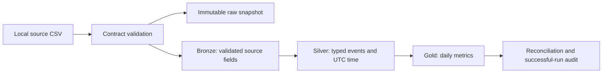

# Data Engineering Lab

[](https://github.com/rohit196/data-engineering-lab/actions/workflows/ci.yml)

A starting point for Rohit Karmudi's next data engineering portfolio project.

**Status: runnable scaffold. The project idea, real data source, and business metrics are still to be chosen.** The six synthetic events in this repository demonstrate engineering behavior; they are not real transactions or evidence of business impact.

## What works today

- A Python CLI and SQL transformations that run locally without cloud credentials.
- A versioned input contract: required fields, unique identifiers, timezone-aware timestamps, nonnegative integer amounts, and empty-file protection.
- Byte-for-byte source snapshots, identified by SHA-256, plus bronze, silver, and gold tables in DuckDB.
- Transactional table replacement, row-count reconciliation, JSON logs, and successful-run history.
- Tests for UTC aggregation, idempotent reruns, bad inputs, rollback, and source integrity.
- Locked dependencies, automated linting, and CI on Windows and Linux.

## Quick start

Install [Python 3.11 or 3.12/3.13](https://www.python.org/downloads/) and [uv](https://docs.astral.sh/uv/getting-started/installation/). Open PowerShell or a terminal:

```sh
git clone https://github.com/rohit196/data-engineering-lab.git
cd data-engineering-lab
uv sync --locked
uv run --locked de-lab --config config/pipeline.toml
```

The run creates ignored local files:

- `data/raw/<source-sha256>.csv`: the exact accepted input.
- `data/warehouse/analytics.duckdb`: the working warehouse.

The final JSON message should report `"event": "pipeline_completed"` and `"rows": 6`. Repeating the command preserves the same analytics results and records a new successful run.

Inspect the output with the included helper:

```sh
uv run --locked python scripts/inspect_warehouse.py
```

Expected gold output:

| UTC date | Category | Events | Unique entities | Amount in cents |
| --- | --- | ---: | ---: | ---: |
| 2026-01-01 | sample_a | 2 | 2 | 2000 |
| 2026-01-01 | sample_b | 2 | 2 | 750 |
| 2026-01-02 | sample_a | 1 | 1 | 2000 |
| 2026-01-02 | sample_b | 1 | 1 | 750 |

The fourth event has a +01:00 timezone offset and belongs to January 1 in UTC. Amounts stay in integer cents throughout; this demo makes no revenue claim.

## Architecture



Bronze, silver, gold, and the successful-run audit commit in one database transaction. The raw file lives outside that transaction. See [architecture and tradeoffs](docs/architecture.md) for guarantees and limits.

## Repository map

```text
.github/                 CI, dependency updates, and planning issue form
config/                  Environment-specific local paths
contracts/               Explicit source schema and quality requirements
data/sample/             Small, synthetic, safe-to-share input
docs/                    Architecture, runbook, project brief, decisions
scripts/                 Warehouse inspection helper
src/de_lab/              Python ingestion, validation, CLI, and SQL models
tests/                   Behavior and failure-recovery tests
pyproject.toml           Package, tools, and direct dependencies
uv.lock                  Resolved dependency versions
```

## Development checks

```sh
uv run --locked ruff check .
uv run --locked ruff format --check .
uv run --locked pytest
```

CI runs those checks and the sample pipeline on Python 3.11 and 3.13 on Linux, plus Python 3.11 on Windows. GitHub Actions are pinned to immutable commit SHAs, with automated update proposals.

## Where we go next

1. Complete the [project brief](docs/project-brief.md): audience, problem, data source, and success criteria.
2. Replace the synthetic contract and ingestion adapter with the selected real source.
3. Build one useful end-to-end result, then measure correctness, freshness, runtime, and cost.
4. Add scheduling, incremental ingestion, and cloud infrastructure when the requirements justify them.
5. Publish an honest case study with a demo, architecture, measured results, and tradeoffs.

See the [roadmap](docs/roadmap.md) and [operating runbook](docs/runbook.md). Generated data and local secrets are ignored; only synthetic sample data belongs in Git.

## Reference documentation

- [DuckDB Python API](https://duckdb.org/docs/stable/clients/python/overview)
- [uv dependency locking](https://docs.astral.sh/uv/concepts/projects/sync/)
- [uv in GitHub Actions](https://docs.astral.sh/uv/guides/integration/github/)
- [GitHub: pinning actions](https://docs.github.com/en/actions/reference/security/secure-use)
